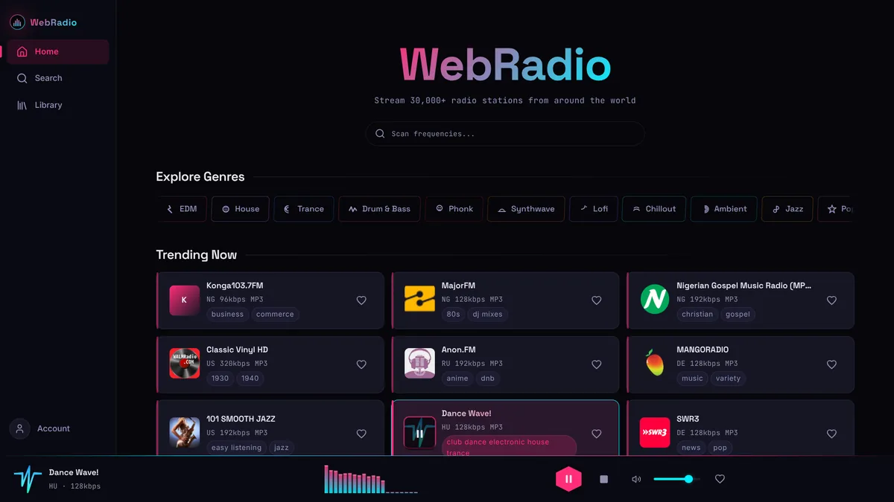
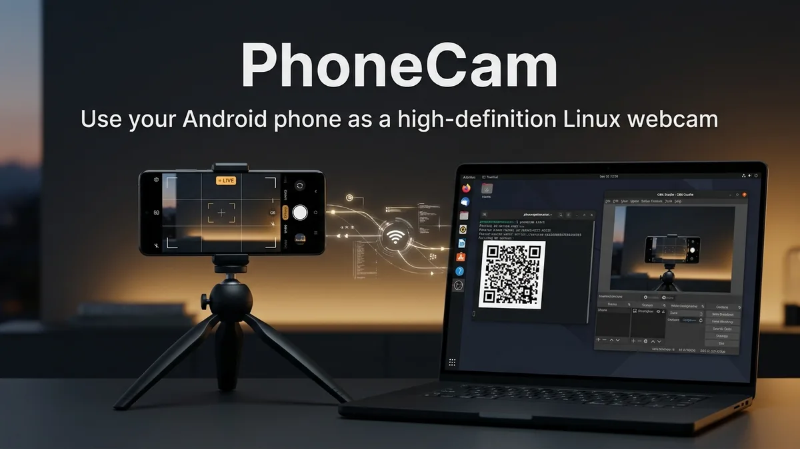
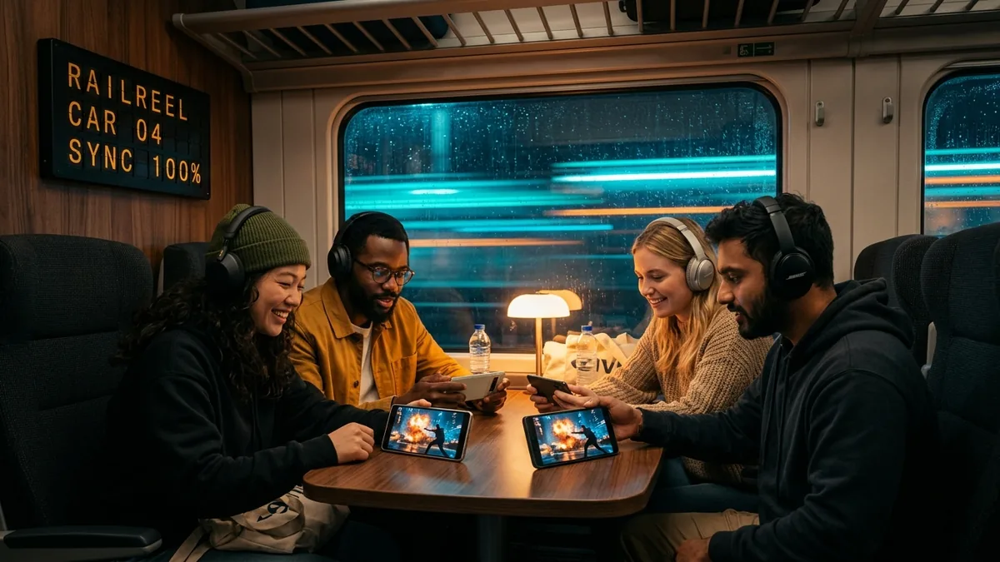
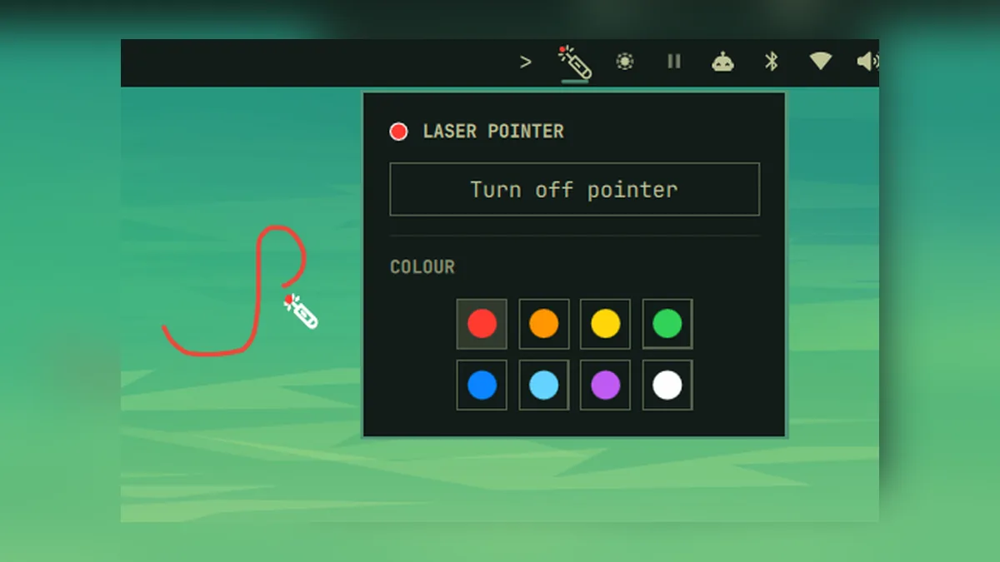
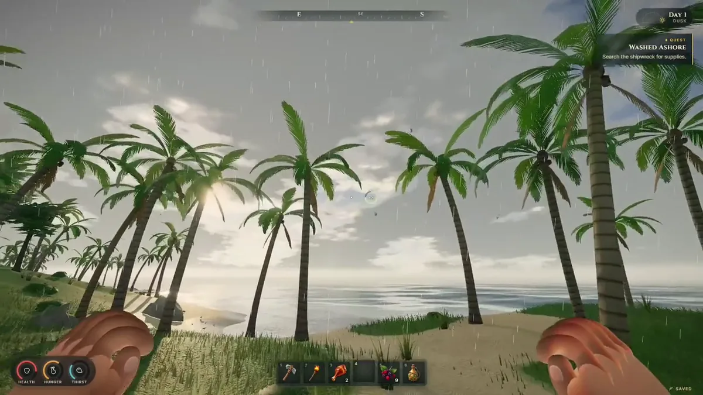
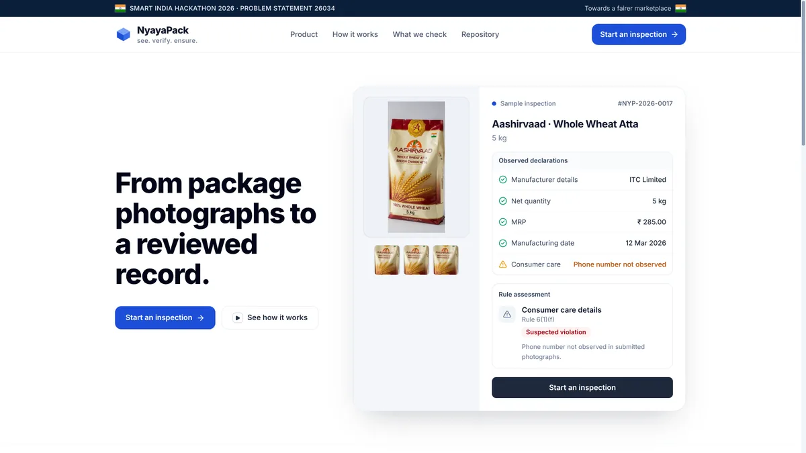

<picture>
  <source media="(prefers-color-scheme: dark)" srcset="assets/header-dark.svg">
  
</picture>

  

I study data science at IIT Madras and build full-stack web apps, Android apps and AI tools. Most of them start as something I wanted for myself: a webcam that isn't grainy, a way to watch movies on a train with no signal, a radio that skips the dead stations. My laptop runs Arch with Hyprland, and I keep writing small tools for it to save a few keystrokes.

[krvaibhav.dev](https://krvaibhav.dev) &nbsp;·&nbsp; [LinkedIn](https://www.linkedin.com/in/krvaibhav-kvm) &nbsp;·&nbsp; [X](https://x.com/krvaibhavm) &nbsp;·&nbsp; [Email](mailto:krvaibhav9999@gmail.com)

  

## Selected work

<table>
  <tr>
    <td width="50%" valign="top">
      
      <h3>WebRadio</h3>
      30,000 radio stations, and only the ones that work. It drops dead streams, merges duplicates and ranks the rest by votes and bitrate. Installs as an app.
        
      <code>React 19</code> <code>TypeScript</code> <code>Supabase</code>
        
      <a href="https://webradio.krvaibhav.dev"><b>Open the app →</b></a>
    </td>
    <td width="50%" valign="top">
      
      <h3>PhoneCam</h3>
      Your phone is a better webcam than your laptop. Pair with a QR code in the terminal and it shows up in Meet, Zoom, Discord and OBS. No cloud in between.
        
      <code>Kotlin</code> <code>Go</code> <code>GStreamer</code> <code>V4L2</code>
        
      <a href="https://github.com/kvm404/phonecam/releases/latest"><b>Download →</b></a> &nbsp; <a href="https://github.com/kvm404/phonecam">Source</a>
    </td>
  </tr>
  <tr>
    <td width="50%" valign="top">
      
      <h3>RailReel</h3>
      A private cinema for trains and flights. One phone hosts, friends join its hotspot, and everyone watches on their own screen in frame-accurate sync. Zero internet.
        
      <code>React Native</code> <code>Expo</code> <code>Kotlin</code>
        
      <a href="https://github.com/kvm404/railreel/releases/latest"><b>Get the APK →</b></a> &nbsp; <a href="https://github.com/kvm404/railreel">Source</a>
    </td>
    <td width="50%" valign="top">
      
      <h3>Omarchy Laser Pointer</h3>
      Draw a glowing trail on your screen while you present, and watch it fade when you let go. Eight colours, a toggle in the bar, one command to install.
        
      <code>QML</code> <code>Quickshell</code> <code>Wayland</code>
        
      <a href="https://github.com/kvm404/omarchy-laser-pointer"><b>Install →</b></a>
    </td>
  </tr>
  <tr>
    <td width="50%" valign="top">
      
      <h3>Embers of Velmora</h3>
      A first-person survival game on a volcanic island, in a browser tab. The island, plants and creatures are procedural, and every sound is synthesized at runtime.
        
      <code>TypeScript</code> <code>Three.js</code> <code>Rapier3D</code>
        
      <a href="https://velmora.krvaibhav.dev"><b>Play it →</b></a>
    </td>
    <td width="50%" valign="top">
      
      <h3>NyayaPack</h3>
      Photograph a package, get a Legal Metrology compliance report. Built with my team for Smart India Hackathon 2026. The OCR runs in the browser.
        
      <code>Next.js</code> <code>TypeScript</code> <code>Tesseract.js</code>
        
      <a href="https://ocr-sih26.vercel.app"><b>Try it →</b></a> &nbsp; <a href="https://github.com/kvm404/ocr-sih26">Source</a>
    </td>
  </tr>
</table>

<b>More projects</b>

  

| Project | What it does | Built with |
| --- | --- | --- |
| [Hospital Management System](https://github.com/kvm404/hospital-management-system) | Three dashboards for admins, doctors and patients, with slot booking and medical history | Flask, SQLite |
| [GoCareer](https://go-career.krvaibhav.dev) | Career suggestions for rural students, with a curated fallback when the AI is down | Express, Gemini |
| [BIS Saarthi](https://github.com/kvm404/SIH107) | Chat assistant for Indian Standards that cites a source for every IS number it gives | FastAPI, SQLite FTS5 |
| [Sundown City Online](https://sundown-city-online.vercel.app) | Open-world sandbox for 100 players with proximity voice, built from one shared seed | Three.js, WebSockets |
| [MediStore](https://github.com/kvm404/MediStore) | Pharmacy inventory with batch tracking, first-expiry-first-out sales and profit reports | Flask |
| Finman | Reads bank and UPI SMS on the phone and turns them into a ledger. No backend | React Native, SQLite |
| Vyom | An Android agent that searches and edits my Obsidian vault, synced over git | Kotlin, Compose |
| Remote Terminal | My laptop's tmux sessions from my phone, over Tailscale | xterm.js, node-pty |

Rows without a link are private repos.

  

## Activity

<picture>
  <source media="(prefers-color-scheme: dark)" srcset="assets/activity-dark.svg">
  
</picture>

  

## Toolkit

| | |
| --- | --- |
| Languages | Python, TypeScript, JavaScript, Kotlin, Go, Java |
| Frontend | React, Next.js, Vue, Three.js, Tailwind CSS |
| Backend and data | FastAPI, Flask, Express, PostgreSQL, MongoDB, SQLite, Supabase, Convex |
| Mobile | React Native, Expo, Jetpack Compose |
| Infra and tools | AWS, Docker, Vercel, Git, Arch Linux, Hyprland, Claude Code, Codex |

  

The activity card rebuilds every day from the GitHub API, using a small workflow in this repo.
