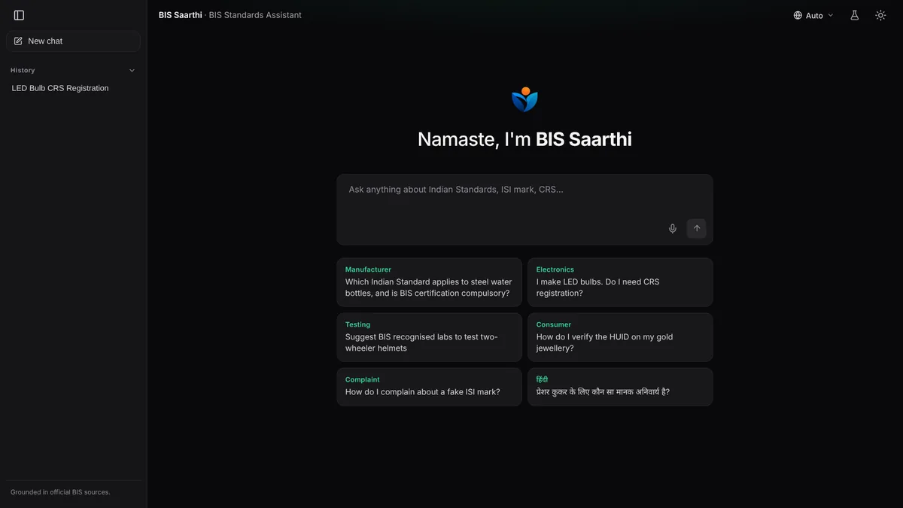
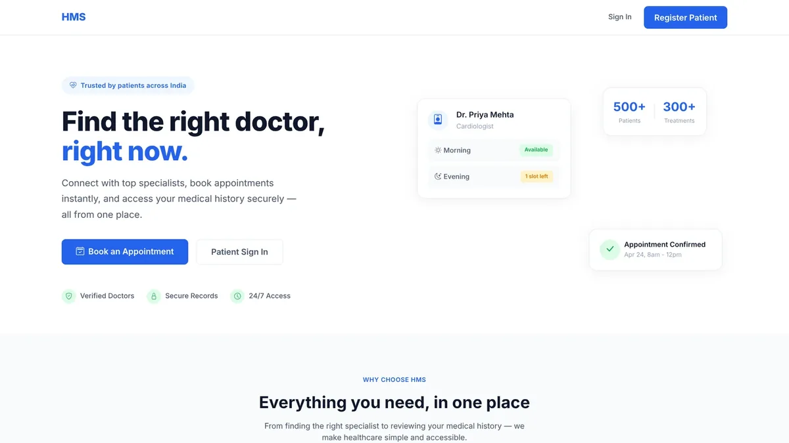
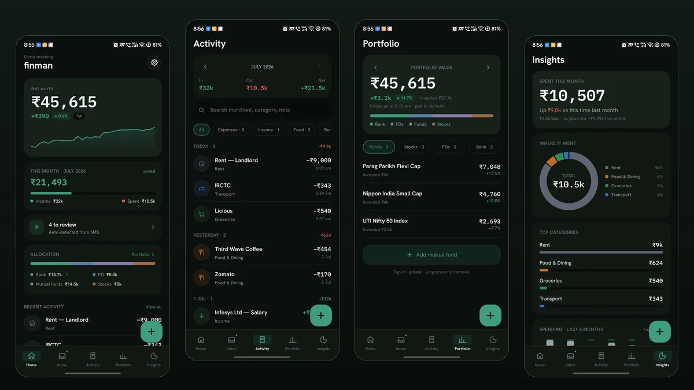
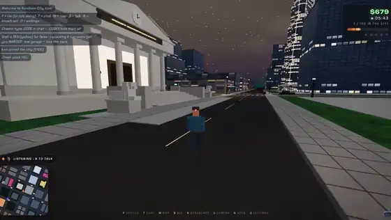
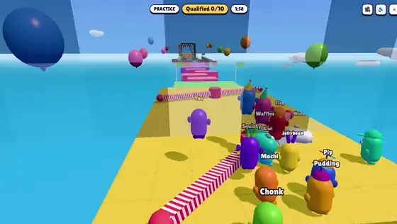

  

  
  
  
  
  

 

I'm a data science student at IIT Madras. I build full-stack web apps, Android apps and AI tools, and on the side I keep tweaking my Linux setup. I like projects with a hard constraint: no internet, no backend, no downloaded assets. Below is most of what I've shipped.

 

## Web

<table>
  <tr>
    <td width="50%" valign="top">
      
      <b>WebRadio</b> &nbsp;Live 
      30,000 stations with the dead streams filtered out, ranked by votes and bitrate. Installs as an app. 
      <a href="https://webradio.krvaibhav.dev">Open</a>
    </td>
    <td width="50%" valign="top">
      
      <b>NyayaPack</b> &nbsp;SIH 2026 
      Photograph a package and get a Legal Metrology compliance report. The OCR runs in the browser. 
      <a href="https://ocr-sih26.vercel.app">Open</a> · <a href="https://github.com/kvm404/ocr-sih26">Source</a>
    </td>
  </tr>
  <tr>
    <td width="50%" valign="top">
      
      <b>BIS Saarthi</b> &nbsp;SIH 2026 
      Chat assistant for Indian Standards, in English or Hindi. Every IS number it gives has to cite a source. 
      <a href="https://github.com/kvm404/SIH107">Source</a>
    </td>
    <td width="50%" valign="top">
      
      <b>Hospital Management System</b> 
      Separate dashboards for admins, doctors and patients, with weekly slot booking and medical history. 
      <a href="https://github.com/kvm404/hospital-management-system">Source</a>
    </td>
  </tr>
</table>

## Android

<table>
  <tr>
    <td width="50%" valign="top">
      
      <b>RailReel</b> &nbsp;Released 
      Watch a movie with friends on a train, each on your own phone, in frame-accurate sync. No internet needed. 
      <a href="https://github.com/kvm404/railreel/releases/latest">APK</a> · <a href="https://github.com/kvm404/railreel">Source</a>
    </td>
    <td width="50%" valign="top">
      
      <b>PhoneCam</b> &nbsp;Released 
      Your phone as an HD webcam for Linux over local Wi-Fi. Works in Meet, Zoom, Discord and OBS. 
      <a href="https://github.com/kvm404/phonecam/releases/latest">Download</a> · <a href="https://github.com/kvm404/phonecam">Source</a>
    </td>
  </tr>
  <tr>
    <td width="50%" valign="top">
      
      <b>Finman</b> &nbsp;Private 
      Reads bank and UPI SMS on the phone and turns them into a ledger. Tracks FDs, mutual funds and stocks. No backend.
    </td>
    <td width="50%" valign="top">
      
      <b>Vyom</b> &nbsp;Private 
      An agent on my phone that searches and edits my Obsidian vault, synced over plain git.
    </td>
  </tr>
</table>

## Games

<table>
  <tr>
    <td width="33%" valign="top">
      
      <b>Embers of Velmora</b> 
      Survive a volcanic island and light the beacon. Every sound is synthesized at runtime. 
      <a href="https://velmora.krvaibhav.dev">Play</a>
    </td>
    <td width="33%" valign="top">
      
      <b>Sundown City Online</b> 
      100 players in one city with proximity voice. The server never sends a single piece of geometry. 
      <a href="https://sundown-city-online.vercel.app">Play</a>
    </td>
    <td width="33%" valign="top">
      
      <b>Rumblebeans</b> 
      16-player knockout party game across nine maps. The server runs every match at 60 Hz.
    </td>
  </tr>
</table>

## Linux

<table>
  <tr>
    <td width="50%" valign="top">
      
      <b>Omarchy Laser Pointer</b> &nbsp;Most starred 
      Draw a glowing trail on screen while you present. Eight colours and a toggle in the bar. 
      <a href="https://github.com/kvm404/omarchy-laser-pointer">Install</a>
    </td>
    <td width="50%" valign="top">
      <b>Also running on my desktop</b>
        
      <b>Remote Terminal</b> 
      My laptop's tmux sessions from my phone, over Tailscale only. Good for checking on a long agent run while I'm out.
        
      <b>Omascreen</b> 
      Screen time in the Omarchy bar. Stores which apps had focus, never the window titles.
        
      <b>Eye-Tracking Recorder</b> &nbsp;In progress 
      A screen recorder that maps where a student looks while reading a PDF, built for a professor's study.
    </td>
  </tr>
</table>

 

## Stats

  <picture>
    <source media="(prefers-color-scheme: dark)" srcset="assets/overview-dark.svg">
    
  </picture>
  <picture>
    <source media="(prefers-color-scheme: dark)" srcset="assets/languages-dark.svg">
    
  </picture>

<picture>
  <source media="(prefers-color-scheme: dark)" srcset="assets/monthly-dark.svg">
  
</picture>

 

## Tools I reach for

  <picture>
    <source media="(prefers-color-scheme: dark)" srcset="assets/stack-dark.svg">
    
  </picture>

 

Stats cards rebuild every night from the GitHub API with a workflow in this repo. Icons from <a href="https://skillicons.dev">skillicons.dev</a>.

