<picture>
  <source media="(prefers-color-scheme: dark)" srcset="assets/bento-dark.svg">
  
</picture>

 

I build things I want to use myself, then keep polishing until other people can use them too. Right now that's [PhoneCam](https://github.com/kvm404/phonecam), which turns an Android phone into a webcam for Linux, and [RailReel](https://github.com/kvm404/railreel), for watching a movie in sync with friends on a train with no internet. More on [krvaibhav.dev](https://krvaibhav.dev).

 

<picture>
  <source media="(prefers-color-scheme: dark)" srcset="assets/rhythm-dark.svg">
  
</picture>

 

### Stack

### Say hi

[Portfolio](https://krvaibhav.dev) · [LinkedIn](https://www.linkedin.com/in/krvaibhav-kvm) · [X](https://x.com/krvaibhavm) · [Email](mailto:krvaibhav9999@gmail.com)

Both grids are SVGs that a workflow in this repo rebuilds every night from the GitHub API. Commit times are in IST.
