### hey, I'm Kumar

I study data science at IIT Madras and build web apps, Android apps and the odd Linux tool. My laptop runs Arch with Hyprland and Omarchy, and a lot of what I make starts as a fix for something on it: a laser pointer for screen shares, a webcam that isn't grainy, a terminal I can reach from my phone.

<br>

## ~/projects

| | Project | What it does | Stack |
| :-: | --- | --- | --- |
| <kbd>live</kbd> | [**WebRadio**](https://webradio.krvaibhav.dev) | 30,000 radio stations with the dead streams already filtered out. Installs as an app. | React 19, TypeScript, Supabase |
| <kbd>release</kbd> | [**PhoneCam**](https://github.com/kvm404/phonecam) | Turns an Android phone into an HD webcam for Linux over local Wi-Fi. Pair with a QR code in the terminal. | Kotlin, Go, GStreamer |
| <kbd>release</kbd> | [**RailReel**](https://github.com/kvm404/railreel) | Watch a movie with friends on a train or flight, each on your own phone, in sync, with no internet. | React Native, Kotlin |
| <kbd>plugin</kbd> | [**Omarchy Laser Pointer**](https://github.com/kvm404/omarchy-laser-pointer) | Draw a fading trail on screen while you present. My most-starred repo. | QML, Quickshell |
| <kbd>live</kbd> | [**NyayaPack**](https://ocr-sih26.vercel.app) | Photograph a package and get a Legal Metrology compliance report. Smart India Hackathon 2026. | Next.js, Tesseract.js |
| <kbd>play</kbd> | [**Embers of Velmora**](https://velmora.krvaibhav.dev) | First-person survival on a volcanic island, in a browser tab. Every sound is synthesized at runtime. | Three.js, Rapier3D |
| <kbd>play</kbd> | [**Sundown City Online**](https://sundown-city-online.vercel.app) | A city sandbox for 100 players with proximity voice chat. The whole map grows from one seed. | Three.js, WebSockets |
| <kbd>repo</kbd> | [**Hospital Management System**](https://github.com/kvm404/hospital-management-system) | Separate dashboards for admins, doctors and patients, with slot booking and records. | Flask, SQLite |
| <kbd>repo</kbd> | [**MediStore**](https://github.com/kvm404/MediStore) | Pharmacy inventory with batch tracking, first-expiry-first-out sales and profit reports. | Flask |

<br>

## try one

```sh
# laser pointer for your Omarchy bar
omarchy plugin add https://github.com/kvm404/omarchy-laser-pointer.git --enable

# phone as a webcam (grab the package from the latest release first)
sudo pacman -U ./phonecam-*-x86_64.pkg.tar.zst
sudo phonecam setup && phonecam start
```

<br>

## ~/.config/stack.toml

```toml
[languages]
daily    = ["TypeScript", "Python", "Kotlin", "Go"]
also     = ["JavaScript", "Java", "QML"]

[web]
frontend = ["React", "Next.js", "Vue", "Three.js", "Tailwind CSS"]
backend  = ["FastAPI", "Flask", "Express"]
data     = ["PostgreSQL", "MongoDB", "SQLite", "Supabase", "Convex"]

[mobile]
android  = ["React Native", "Expo", "Jetpack Compose"]

[ops]
cloud    = ["AWS", "Vercel", "Docker"]
desktop  = ["Arch Linux", "Hyprland", "Omarchy"]
agents   = ["Claude Code", "Codex"]
```

<br>

## ~/links

[`krvaibhav.dev`](https://krvaibhav.dev) &nbsp; [`linkedin`](https://www.linkedin.com/in/krvaibhav-kvm) &nbsp; [`x.com/krvaibhavm`](https://x.com/krvaibhavm) &nbsp; [`email`](mailto:krvaibhav9999@gmail.com)

<br>

<sub>The desktop at the top is an SVG. A GitHub Action rebuilds it every night from the GraphQL API, so the numbers stay current.</sub>
