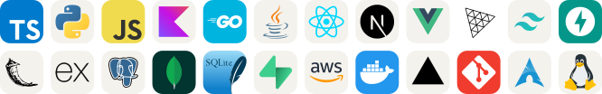

  

  
  
  
  
  

 

I'm a data science student at IIT Madras. I build full-stack web apps, Android apps and AI tools, and I spend too much time tuning my Arch setup. My favourite projects come with a hard constraint, like no internet, no backend or no downloaded assets. You can see them all on [krvaibhav.dev](https://krvaibhav.dev).

 

## By the numbers

  <picture>
    <source media="(prefers-color-scheme: dark)" srcset="assets/overview-dark.svg">
    
  </picture>
  <picture>
    <source media="(prefers-color-scheme: dark)" srcset="assets/languages-dark.svg">
    
  </picture>

  <picture>
    <source media="(prefers-color-scheme: dark)" srcset="assets/monthly-dark.svg">
    
  </picture>

## How I work

  <picture>
    <source media="(prefers-color-scheme: dark)" srcset="assets/clock-dark.svg">
    
  </picture>
  <picture>
    <source media="(prefers-color-scheme: dark)" srcset="assets/repos-dark.svg">
    
  </picture>

  <picture>
    <source media="(prefers-color-scheme: dark)" srcset="assets/years-dark.svg">
    
  </picture>
  <picture>
    <source media="(prefers-color-scheme: dark)" srcset="assets/churn-dark.svg">
    
  </picture>

 

## Tools I reach for

  <picture>
    <source media="(prefers-color-scheme: dark)" srcset="assets/stack-dark.svg">
    
  </picture>

 

Every card here is an SVG that a workflow in this repo rebuilds each night from the GitHub API. Commit times are in IST. Icons from <a href="https://skillicons.dev">skillicons.dev</a>.

