### hey, I'm Kumar

I study data science at IIT Madras and build web apps, Android apps and the odd Linux tool. My laptop runs Arch with Hyprland and Omarchy, and a lot of what I make starts as a fix for something on it: a laser pointer for screen shares, a webcam that isn't grainy, a terminal I can reach from my phone.

<br>

## how to read the monitor

```text
contributions   one column per day for the last 26 weeks, green to red as it gets busier
weekday list    my share of the year's work on each day of the week
languages       bytes of code across my repos, markup left out
lines           lines added (up) and removed (down) per month
repos           where my commits went in the last 12 months
```

<br>

## ~/.config/stack.toml

```toml
[languages]
daily    = ["TypeScript", "Python", "Kotlin", "Go"]
also     = ["JavaScript", "Java", "QML"]

[web]
frontend = ["React", "Next.js", "Vue", "Three.js", "Tailwind CSS"]
backend  = ["FastAPI", "Flask", "Express"]
data     = ["PostgreSQL", "MongoDB", "SQLite", "Supabase", "Convex"]

[mobile]
android  = ["React Native", "Expo", "Jetpack Compose"]

[ops]
cloud    = ["AWS", "Vercel", "Docker"]
desktop  = ["Arch Linux", "Hyprland", "Omarchy"]
agents   = ["Claude Code", "Codex"]
```

<br>

## ~/links

[`krvaibhav.dev`](https://krvaibhav.dev) &nbsp; [`linkedin`](https://www.linkedin.com/in/krvaibhav-kvm) &nbsp; [`x.com/krvaibhavm`](https://x.com/krvaibhavm) &nbsp; [`email`](mailto:krvaibhav9999@gmail.com)

<br>

<sub>The monitor is one SVG that a GitHub Action redraws every night from the GraphQL API. No btop was harmed.</sub>
