<picture>
  <source media="(prefers-color-scheme: dark)" srcset="assets/skyline-dark.svg">
  
</picture>

  

I study data science at IIT Madras and build full-stack web apps, Android apps and AI tools. Most of them start as something I wanted for myself: a webcam that isn't grainy, a way to watch movies on a train with no signal, a radio that skips the dead stations. My laptop runs Arch with Hyprland, and I keep writing small tools for it to save a few keystrokes.

[krvaibhav.dev](https://krvaibhav.dev) &nbsp;·&nbsp; [LinkedIn](https://www.linkedin.com/in/krvaibhav-kvm) &nbsp;·&nbsp; [X](https://x.com/krvaibhavm) &nbsp;·&nbsp; [Email](mailto:krvaibhav9999@gmail.com)

 

<picture>
  <source media="(prefers-color-scheme: dark)" srcset="assets/pulse-dark.svg">
  
</picture>

  

<picture>
  <source media="(prefers-color-scheme: dark)" srcset="assets/orbit-dark.svg">
  
</picture>

  

| | |
| --- | --- |
| Languages | Python, TypeScript, JavaScript, Kotlin, Go, Java |
| Frontend | React, Next.js, Vue, Three.js, Tailwind CSS |
| Backend and data | FastAPI, Flask, Express, PostgreSQL, MongoDB, SQLite, Supabase, Convex |
| Mobile | React Native, Expo, Jetpack Compose |
| Infra and tools | AWS, Docker, Vercel, Git, Arch Linux, Hyprland, Claude Code, Codex |

 

Every chart here is an SVG that a workflow in this repo redraws each night from the GitHub API. Commit times are in IST.
